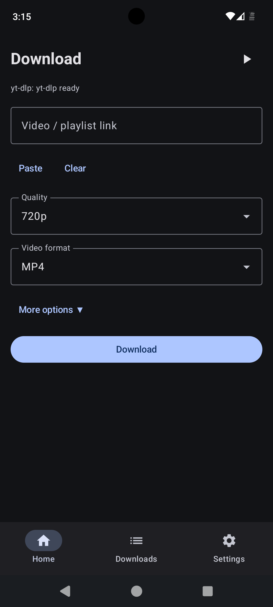
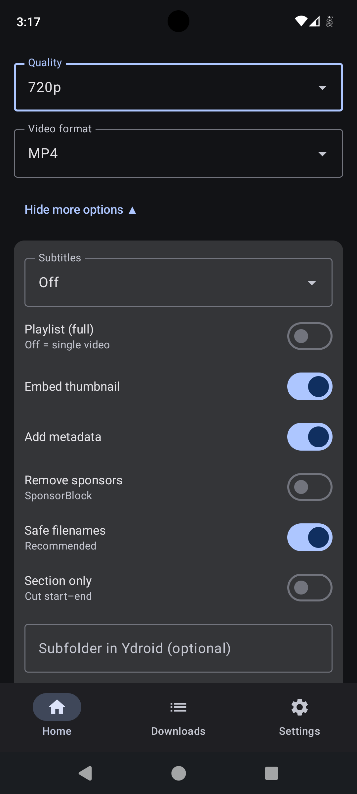
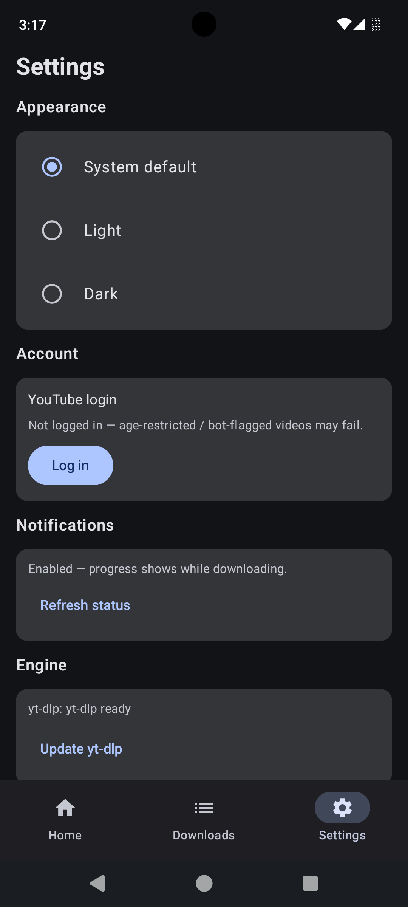

# Ydroid

An Android video downloader powered by **yt-dlp**. Paste a link, pick quality, download to your phone. Supports 1000+ sites (YouTube, Instagram, TikTok, Twitter/X, Vimeo, …).

- Package: `com.ydroid.app`
- Version: 1.2.0 (versionCode 3)
- Min SDK 34 (Android 14+) · Target/Compile SDK 37

## Screenshots

| Home | More options | Settings |
|---|---|---|
|  |  |  |

## Features

- **Download** any yt-dlp-supported link with live progress
- **Preview**: paste a link to auto-fetch thumbnail, duration and an estimated size for every quality
- **Quality**: Best (default) / 4K / 1440p / 1080p / 720p / 480p / 360p / Audio-only
- **Formats**: MP4 / MKV / WebM video · MP3 / M4A / Opus audio
- **Subtitles**: off / embed English / English `.srt` / all languages
- **Playlists**: full or pick individual videos (flat-list picker, `--playlist-items`)
- **Auto `.m3u`**: playlist downloads write a `<title>.m3u` queue file; multi-select export in Files
- **Section cut**: download only `start–end` (`--download-sections`, ffmpeg-backed)
- **Queue**: jobs run one-by-one with Queued/Active/Done/Failed states, badge count, retry, pause/resume
- **Background downloads**: foreground service + notification, survives leaving the app
- **Resume**: `--continue` + retries pick up `.part` files after stop/kill; queue persists across restarts
- **YouTube login** (Settings → Account): in-app WebView sign-in saves `cookies.txt` to beat bot-checks and age gates
- **Update yt-dlp** in-app (Settings → Engine) when sites change extractors
- **Download location** (Settings → Storage): pick any folder or SD card; new downloads move there, older files stay put
- **Subfolder** per download inside the chosen location
- **Extras**: embed thumbnail/metadata, SponsorBlock removal, safe filenames, free-form yt-dlp flags
- **Files tab**: browse, select, delete (single + bulk), share, open, refresh
- **Appearance**: System / Light / Dark theme
- **Share-in**: send any link to Ydroid from other apps to auto-fill

## Install

Grab the APK from Releases (or `app/build/outputs/apk/release/`):

| Device | File |
|---|---|
| Most modern phones (arm64) | `app-arm64-v8a-release.apk` (~77 MB) |
| Older 32-bit phones | `app-armeabi-v7a-release.apk` |
| Emulator (x86_64) | `app-x86_64-release.apk` |
| Unsure | `app-universal-release.apk` (~215 MB) |

1. Uninstall any older Ydroid build first — the app ID is now `com.ydroid.app`, so it installs as a separate app.
2. Install the APK (sideload — allow "install unknown apps" when asked).
3. Open once: yt-dlp + Python unpack on first run (~30 s), allow notifications when prompted.

By default files land in **Downloads/Ydroid**. Change this in **Settings → Storage** to any folder or SD card.

## Usage

1. **Home**: paste a link (details load automatically: thumbnail, duration, estimated size) → pick Quality → Download.
2. **More options**: subtitles, playlist toggle + Pick videos, section cut, subfolder, extra flags.
3. **Queue** (play icon in the header): watch jobs progress, retry failures, clear finished.
4. **Downloads/Files**: open, share, delete, export `.m3u` (shows both Downloads/Ydroid and your chosen folder).
5. **Settings**: YouTube login, yt-dlp update, download location, theme, notifications.

## Permissions — why no storage prompt?

On Android 14+ there is no `WRITE_EXTERNAL_STORAGE` anymore. Writing to `Downloads/Ydroid` is whitelisted and listing your own files needs no permission, so the app never prompts for storage. A custom folder or SD card is accessed through the system folder picker (SAF), so no storage permission is needed there either. `READ_MEDIA_VIDEO` is declared for reading shared media; `POST_NOTIFICATIONS` + foreground-service permissions power background download progress.

## Build from source

Requirements: JDK 17+, Android SDK with platform 37, ~8 GB free (native Python/ffmpeg libs are large).

```bash
./gradlew :app:assembleDebug      # debug APKs (fast)
./gradlew :app:assembleRelease    # release APKs (signed with debug key — replace signingConfig for public releases)
```

Per-ABI APKs are in `app/build/outputs/apk/<debug|release>/`.

## How it works

- [`youtubedl-android`](https://github.com/yausername/youtubedl-android) bundles Python + yt-dlp + ffmpeg (`--ffmpeg-location` is wired automatically for merges, MP3 extraction, section cuts, thumbnail/subtitle embeds).
- `YdlManager` builds the yt-dlp request (format selector caps like `bestvideo[height<=720]+bestaudio/…`, `--merge-output-format`, `--embed-thumbnail`, `--sponsorblock-remove`, …).
- `DownloadRepository` + `DownloadService` (foreground, `dataSync`) run jobs sequentially with a persisted queue; `--continue --retries 10` resumes `.part` files.
- `DownloadPrefs` stores the global SAF destination. yt-dlp stages into `Downloads/Ydroid`, then new files are moved to the chosen folder; files downloaded before a change are left untouched.
- Cookies from the login WebView are written as Netscape `cookies.txt` and passed via `--cookies`.

## Known limits

- Killing the app mid-download relies on service restart + `--continue`; reboot-persistence is not implemented.
- Some videos need login (age-gated) or fresh yt-dlp (extractor changes) — use Settings → Account / Update yt-dlp.
- Custom folders/SD cards are move-after-download (yt-dlp writes to `Downloads/Ydroid` first, then the app moves the new files). This temporarily needs free space in internal storage for large files.

## Disclaimer

Downloading videos may violate the source site's Terms of Service (e.g. YouTube). This project is for personal/educational use. Distribute and use responsibly — that's why releases are sideload APKs, not a Play Store listing.

## License

GPL-3.0 (inherited from the yt-dlp Android wrapper this app builds on). See `LICENSE`.
